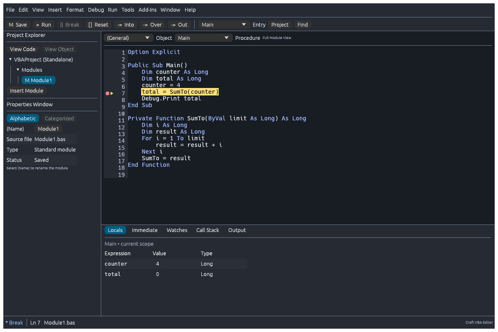
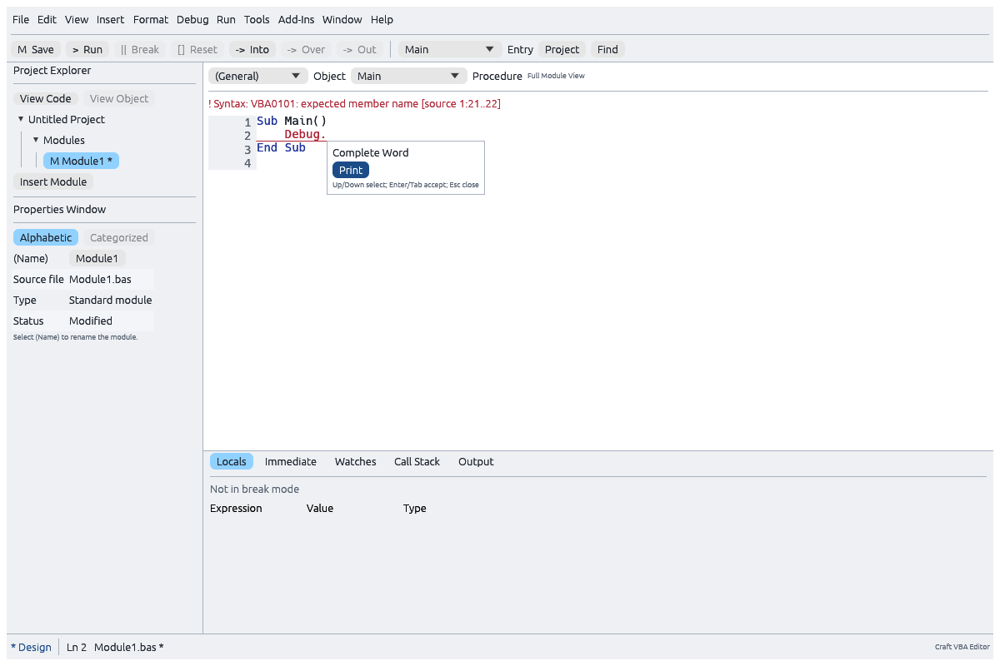

# tiny-vba

M7A.1–M7A.7 are complete for the [common native forms profile](docs/m7a-acceptance.md).
Native `.frm`/`.frx` and edited XLSM/DOCM copy workflows are accepted, and the
custom format is removed. [M8.1–M8.4 local conformance and hardening](docs/m8-acceptance.md)
are complete: 24 additional inherited library cases, bounded fuzzing, eight
asserted native/WASI benchmarks and 20 original workbook workflows, with passing
native/WASM/UI/browser gates. Fresh Excel/Word comparison (M8.5) remains NOT_RUN,
so full M8 release acceptance stays open. P9 remains deferred. These finite
profiles do not imply universal Office parity.

**A clean-room VBA implementation for the ArtCraft applications: GridCraft, WordCraft and DeckCraft.**

Written in Rust, tiny-vba provides the shared language engine, runtime, editor and
debugger for native and WebAssembly applications. Its purpose is to let people bring
their VBA knowledge—and, as compatibility grows, their existing macros—to ArtCraft.
The maintainer's GridCraft and WordCraft forks embed it through opt-in integrations
on feature branches. **These integrations are not part of official upstream builds.**
DeckCraft is an intended host, with no integration claimed here yet.



## Why VBA matters to the whole suite

For ArtCraft, Excel compatibility is essential to adoption. A business might accept
some differences in how a word processor or presentation app works. A spreadsheet
that runs its reporting, pricing or operations has to keep working. Rewriting years
of VBA is rarely an acceptable migration plan.

That makes VBA fidelity a suite-wide requirement. Gaps in Excel macro compatibility
have been a major barrier to business adoption of open-source office suites: if a
business cannot move its spreadsheets, it has little reason to move the rest of its
Office workflow. Excellent word processing and presentations alone cannot solve
that problem.

tiny-vba exists to address this barrier. **High Excel/VBA compatibility is the design
goal; universal compatibility is not a claim about today's implementation.**

## Designed for compatibility and familiarity

- **Preserve VBA runtime behaviour.** Types, coercion, `ByRef`, arrays and their lower
  bounds, error handling, classes, properties, events and persistent state matter as
  much as recognizing syntax. `Empty`, `Null`, `Missing`, `Nothing`, Currency and Date
  retain their distinct meanings.
- **Make existing VBA skills useful immediately.** Project Explorer, Properties,
  module/procedure views, IntelliSense-style assistance, Immediate, Locals, Watches
  and Call Stack provide a familiar editing and debugging workflow, with familiar
  shortcuts such as F5, F8 and F9.
- **Use the application's real objects.** GridCraft owns the Excel-compatible
  workbook object model; WordCraft owns the Word-compatible document object model.
  Macros work through the host's native document engine, undo, protection and
  recalculation rather than a separate copy of the document.
- **Share the same engine across platforms and apps.** The compiler, VM and debugger
  support native and WebAssembly use. Apps embed the same editor and debugger with
  their own theme, fonts and application services.
- **Measure compatibility honestly.** Unsupported operations fail explicitly.
  Authored tests, inherited reference results and fresh Microsoft Office comparisons
  are reported separately. Passing one profile does not establish all of VBA or Excel.

Clean-room means independently authored code informed by public specifications,
documentation and permitted black-box observations. No Microsoft implementation
code, proprietary Office binaries or vendor artwork is included.

## In-process execution: compatibility and speed

tiny-vba runs **inside the host application**, with native Rust calls between the
VBA engine and the application's object model. This is central to two goals:

- **Compatibility:** high Excel fidelity needs tightly integrated access to
  GridCraft's live workbook state, object identities, events, calculation and undo
  behaviour. In-process integration lets the VBA adapter coordinate directly with
  those systems and preserve their semantics as a macro executes.
- **Speed:** even a simple macro that loops over cells can make thousands of
  object-model calls in one run. Sending every property read, write and method call
  through an API to a separate process would add serialization, transport and
  process-boundary overhead repeatedly, potentially dominating the actual work.
  Native in-process dispatch avoids that overhead on the macro execution path.

The same approach applies to WordCraft's document objects. External control APIs
and the optional DAP debugger serve other clients; they are not the route used for
ordinary VBA object-model calls. GridCraft's separate editor window is another
window in the same process, using the same interpreter and workbook integration.

## Editor



The reusable editor offers:

- **Code assistance:** scoped word and member completion, signature/parameter help,
  Quick Info, List Constants, definition navigation and an Object Browser. Host
  catalogues supply the supported Excel or Word members without executing them.
- **Readable source:** VBA syntax colouring, line numbers, live red/underlined parser
  diagnostics, breakpoint markers and current-statement highlighting. Hidden VBA
  attributes stay out of the normal code view while remaining in the stored source.
- **Everyday editing:** undo/redo, clipboard operations, block indent/outdent and
  comments, automatic indentation/case correction, and literal Find/Replace across
  a procedure, module or project, with case and whole-word options.
- **Project navigation:** Project Explorer, Properties, module and procedure
  selectors, procedure-only and split views, bookmarks and navigation history.
- **Workspace controls:** light/dark and host-supplied themes, pane placement,
  toolbar preferences, keyboard access and accessible control labels.

The form designer adds a Toolbox, Properties, drag/resize, alignment, tab order and
event-handler navigation for the implemented **Label, TextBox and CommandButton**
profile. Forms run through the real VM and can be debugged during modal or modeless
interaction. Native `.frm`/`.frx` forms are the supported file exchange; the
custom format and its importer/exporter are removed under
[ADR 0099](docs/decisions/0099-native-only-form-workflows.md). New forms start from
native templates. [M7A.5](docs/m7a5-acceptance.md) implements native file Save/Export
and edited XLSM/DOCM copy export; ordinary document Save preserves original VBA
bytes. The [common profile](docs/m7a4-common-profile.md) defines supported controls
and runtime behavior; uncommon extensions remain in P9. M7A.6 removal and its shared/host gates are complete; next is M7A.7 combined
acceptance.

## Debugger

Break, inspect and resume execution in the same editor:

| Feature | What you can do |
|---|---|
| Breakpoints and execution | Toggle statement breakpoints; Run/Continue, Break and Reset; see the current statement |
| Stepping | Step Into, Step Over and Step Out through VBA procedures |
| Locals and Call Stack | Inspect typed values and arrays, navigate stack frames and edit supported local values while paused |
| Watches and Quick Watch | Evaluate read-only expressions, inspect array elements and break when a watch condition is true or its value changes |
| Immediate and Output | Inspect expressions and read `Debug.Print` output; optionally enable bounded, isolated function evaluation |
| Error trapping | Choose the supported VBA error-trapping modes and inspect fault state |
| Set Next Statement | Relocate within verified straight-line checkpoints in the current frame; unsupported jumps are refused |
| Optional DAP adapter | Use the CLI's Debug Adapter Protocol frontend with an external client |

Watch evaluation does not call functions or property getters. Immediate function
calls require explicit opt-in and use an isolated VM; permitted host effects are
real. Reset clears runtime state but does not undo document changes already made.
See [debugger behaviour](docs/debugger.md) and
[advanced-tool acceptance](docs/ui/m10-implementation.md) for the exact boundaries.

| Shortcut | Action |
|---|---|
| F5 / F9 | Run or Continue / toggle breakpoint |
| F8 / Shift+F8 / Ctrl+Shift+F8 | Step Into / Over / Out |
| Shift+F9 | Quick Watch |
| Ctrl+G / Ctrl+L | Immediate / Call Stack |
| Ctrl+R / F4 / F2 | Project Explorer / Properties / Object Browser |
| Ctrl+Space / Ctrl+J | Completion |

## Try it in GridCraft

The integration lives in the maintainer's
[GridCraft fork, on `feat/tiny-vba-integration`](https://github.com/matt123p/gridcraft/tree/feat/tiny-vba-integration),
not the official upstream build or the fork's `main` branch.
`crates/vba` owns the Excel object adapter, and the application embeds tiny-vba's
editor/debugger. Build the feature branch with VBA enabled:

```sh
git clone --branch feat/tiny-vba-integration --single-branch https://github.com/matt123p/gridcraft.git
cd gridcraft

# Embedded editor
cargo run -p gridcraft --features vba

# Or a separate native editor window (includes the vba feature)
cargo run -p gridcraft --features vba-window
```

1. Open or create a workbook. Enable **Developer** under **File > Options >
   Customize Ribbon > Main Tabs**, then choose **Developer > Visual Basic**, or
   press **Alt+F11**. **Alt+F8** opens the macro picker; **Edit** opens a procedure.
2. Add a standard module, or import plain `.bas` source. New projects start blank.
3. Try this small workbook macro:

```vb
Public Sub HelloGridCraft()
    Range("A1").Value = "Hello from VBA"
    Range("B1").Value = 6 * 7
End Sub
```

4. Click **Allow VBA for this editor session**, select `HelloGridCraft`, then Run.
   Return to the workbook to see the text and `42`. For a debugger tour, set a
   breakpoint with F9 and use F8 to step through the assignments.

The current adapter covers a growing Excel-compatible profile: Application,
Workbook, Worksheet, ranges and collections, values/formulas, formatting, data
operations, tables, events and worksheet UDFs, each with documented limits. Writes
use GridCraft's own protection, undo and recalculation paths.

Opening workbook source does not execute it. Edited source can be stored in
GridCraft's workbook storage or exported as plain modules; it does not rewrite the
original `vbaProject.bin`. Arbitrary existing `.xlsm` macros are not yet guaranteed
to run unchanged. Follow the [GridCraft integration guide](https://github.com/matt123p/gridcraft/blob/feat/tiny-vba-integration/docs/vba.md)
and [Excel compatibility audit](https://github.com/matt123p/gridcraft/blob/feat/tiny-vba-integration/docs/vba-excel-compatibility.md)
for the current member-by-member scope and browser build instructions.

## Try it in WordCraft

The integration lives in the maintainer's
[WordCraft fork, on `feat/vba-host-integration`](https://github.com/matt123p/wordcraft/tree/feat/vba-host-integration),
not the official upstream build or the fork's `main` branch.
`crates/vba` owns the Word object adapter and document lifecycle. Build the feature
branch with VBA enabled:

```sh
git clone --branch feat/vba-host-integration --single-branch https://github.com/matt123p/wordcraft.git
cd wordcraft
cargo run -p wordcraft --features vba
```

1. Create a blank document, then choose **View > Macros > Visual Basic** or press
   **Alt+F11**.
2. Add a standard module or import a `.bas` file containing:

```vb
Public Sub HelloWordCraft()
    ActiveDocument.Content.InsertBefore "Hello from VBA!"
End Sub
```

3. Enable the editor's per-document **trust checkbox**, select `HelloWordCraft` and
   Run. The text appears in the document; successful text mutations in a macro share
   one undo step. F9 and F8 use the same breakpoint and stepping workflow as GridCraft.

The current Word profile exposes Application, Document, Selection and live Range
objects for supported plain main-story paragraphs, plus selected document and
Application events. Tables, inline-object position mapping and the broader Word
object model remain outside this profile. Importing source is inert; automatic
attachment/execution of a document package's VBA on Open/New is not implemented.
Plain-source save/export is separate from binary `.docm` project writeback.
See the [WordCraft integration guide](https://github.com/matt123p/wordcraft/blob/feat/vba-host-integration/docs/vba-integration.md)
for supported members, trust, events, native/browser source transfer and limitations.

Both fork integrations consume an immutable Git revision of tiny-vba; neither needs a sibling
tiny-vba checkout. Each app's pinned revision determines its available features.

## Current compatibility and remaining work

The shared engine, editor/debugger, read-only project importer, selected
class/form profile and declared intrinsic-function profile are implemented.
M1–M6, M6A and the [M7 authored package profile](docs/m7-acceptance.md) are complete
for their declared profiles.
See the [compatibility matrix](docs/compatibility-matrix.md) and
[intrinsic inventory](docs/vba-intrinsic-functions.md) for actual support.

The recorded language acceptance includes **44 authored scenarios and 153 reviewed
ReflexGrid cases passing**. The latter match inherited, upstream-reported Excel Mac
expectations; they are not fresh local Office comparisons or a measure of all VBA.
The [oracle report](docs/m4-oracle-report.md) records their provenance.

Next is M7A: native Office forms and removal of `.tvform`, followed by expanded
conformance, hardening and release validation (M8). Fresh
Excel/Word comparisons remain **NOT_RUN**, scheduled for M8.5. The
[reviewed writeback/signature contract](docs/decisions/0037-m7-package-preservation-and-writeback.md)
describes the original preservation boundary; [ADR 0098](docs/decisions/0098-native-form-encoding-and-source-only-writeback.md)
and the [M7A.5 workflow](docs/m7a5-acceptance.md) add explicit native form saving
and edited XLSM/DOCM copy export. Ordinary document Save preserves imported VBA
bytes; cryptographic signature verification/resigning remains unsupported.
M7 preserves original project bytes and supported related payloads separately
from plain-source exports. Arbitrary COM/DLL execution, P-code execution and
third-party ActiveX/OLE controls are outside the current scope. Broader Office
forms/controls are scheduled in the [M7A work breakdown](docs/office-forms-controls-implementation-plan.md).
The standing [compatibility-only policy](docs/decisions/0038-native-office-forms-and-compatibility-only.md) targets Excel/Word
behavior and native formats; it does not authorize custom user-facing extensions.

## Develop and test tiny-vba

The standalone shell lets you try the same shared components without an ArtCraft
app or Microsoft Office. It is a development/test host for the embedded experience.
Use the Rust toolchain pinned in `rust-toolchain.toml`; Python 3.11+ supports
repository checks and Node 18+ runs the WASI smoke gate.

```sh
cargo run -p vba-ide-app
# Current legacy form example; M7A replaces this format with native Office forms.
cargo run -p vba-ide-app -- --open examples/forms/CustomerForm.frm
cargo run -p vba-cli -- run examples/pure-vba/Arithmetic.bas --entry Answer
cargo run -p vba-cli -- debug examples/pure-vba/Arithmetic.bas --entry Answer
cargo run -p vba-cli -- --help
```

The default IDE demo starts at `Main`: F9 sets a breakpoint, F5 runs and F8 steps.
The CLI example's `Answer` function returns `42`. For an optional external debugger,
run `cargo run -p vba-cli --features dap -- dap examples/pure-vba/Arithmetic.bas`.
See the [embedding and browser guide](docs/ui/embedding.md) for web setup and Rust integration.

```sh
cargo xtask ci
# Optional real package workflows with GridCraft/WordCraft sibling checkouts:
cargo xtask m7
rustup target add wasm32-unknown-unknown wasm32-wasip1
cargo xtask wasm
cargo xtask wasm-run
cargo xtask ui
```

Core builds/tests work without corpus checkouts or application siblings. External
test material is optional and must follow the [corpus policy](tests/corpora/README.md):

```sh
git submodule update --init --checkout --depth 1
cargo xtask corpora
```

Contributions should include focused regressions and precise support claims:
types, errors, side effects and pause/resume behaviour matter. Start with the
[development guide](docs/developer-guide.md), [architecture](docs/architecture.md),
[remaining plan](docs/implementation-plan.md) and [agent guidance](AGENTS.md).
The [documentation index](docs/README.md) links the detailed contracts and evidence.

## License and credits

tiny-vba is dual-licensed under [MIT](LICENSE-MIT) or [Apache-2.0](LICENSE-APACHE),
at your option, matching GridCraft and WordCraft. See [LICENSE](LICENSE).
Existing copyright notices are retained. Dependencies, fonts, external fixtures
and reference submodules keep their own licenses and notices; see
[UI dependency/font notices](docs/provenance/ui-dependencies.json) and
[source provenance](references/sources.lock.json).

The README images are original renders of tiny-vba's shared UI, not Microsoft
Office screenshots. Their [capture sources and attribution](docs/images/README.md)
are recorded alongside them. VBA, Excel, Word and PowerPoint are Microsoft
trademarks; this independent project is not affiliated with or endorsed by Microsoft.

M7A.3 (2026-11-04): GridCraft implements the nine standard native worksheet Form
Controls for [worksheet-form-controls-v1](docs/m7a-worksheet-controls.md).
Model/engine/XLSX own state, commands and packaging; the optional adapter/shell own
VBA bindings, trusted launches and input. No shared crate/dependency edge changed.
Native UserForm semantics/persistence and .tvform removal remain M7A.4–M7A.7.

[ADR 0051](docs/decisions/0051-native-unbound-listbox.md) adds selected native unbound
ListBox decoding, ten-column indexed rows, selection/default Value and ordinary
Change/Click frames. Authorized shared list input uses canonical state and
preserves focus/validation and Stop/resume. Whole-array APIs, further list/binding
semantics and ComboBox remain open with the unchanged broader M7A.4 scope.

[ADR 0052](docs/decisions/0052-native-combobox.md) adds the selected native editable/
drop-list ComboBox packet, shared ordinary list rows, text/selection/matching and
VM-owned drop state. Authorized input preserves focus/validation and debugger
continuations; contextual F4 leaves the editor shortcut intact elsewhere. Locale
limits, further properties/bindings/resources and broader M7A.4 remain open.

M8 release readiness: `python3 tools/check_m8_release.py` checks the local receipts
and fresh Office comparison bundle when supplied. [Capture protocol](docs/m8-office-comparison.md)
and an empty eleven-case template are prepared; actual Office comparison remains NOT_RUN.
